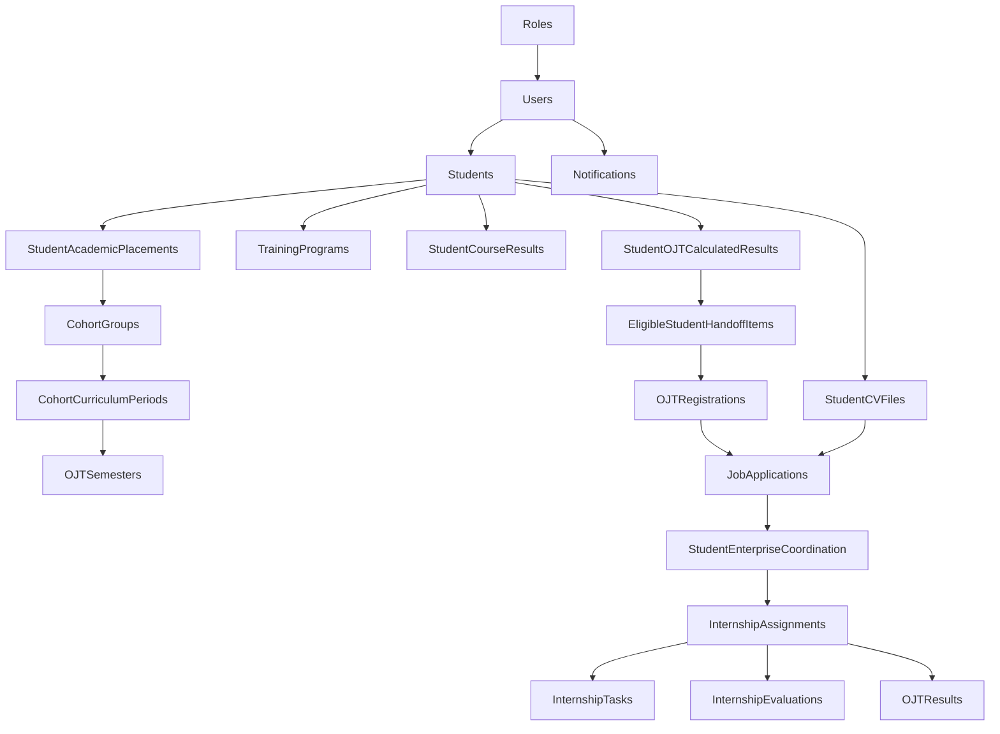

# Đối soát luồng sinh viên — cập nhật 29/10/2026

Phạm vi: source frontend/backend hiện tại, DB PostgreSQL được cấu hình trong dự án, các API của STUDENT và điểm nối bàn giao Đào tạo → QHDN → ứng tuyển → doanh nghiệp. Giữ các thay đổi đã có trong working tree; không reset DB.

## Kết quả kiểm tra lại ngày 29/10/2026

- Toàn bộ HTTP trong `frontend/src` dùng Axios/XHR chung, kể cả upload/tải PDF. Đã bỏ kiểu khai báo Axios tự viết vì nó che kiểu thật của thư viện. `studentService.ts` giữ tên file đang được dùng trong working tree.
- Chrome headless: 16 kiểm tra transport đạt; 13 request thực sự gửi đều là XHR, 0 Fetch. Kiểm tra JSON, bearer token, multipart boundary, blob, mã lỗi backend, timeout và cancellation. Hook bỏ request đã cleanup trước dispatch; trang tiến độ gộp phân công/nhiệm vụ thành một request.
- DB đang cấu hình: 20 tài khoản sinh viên đều liên kết hồ sơ, 183 khóa ngoại trong nhóm liên quan không có bản ghi mồ côi. Đã validate khóa ngoại import còn thiếu; toàn schema public hiện không có FK chưa validate. Không reset hoặc sửa các dòng dữ liệu đang dùng.
- `backend/DB` đã được chạy nguyên file trên PostgreSQL trống, rồi chạy lần hai trên chính DB tạm đó. Không cần migration/seed SQL khác. Đã sửa FK import còn `NOT VALID` và bổ sung acceptance cho liên kết student01, kỳ OJT 6 và nguồn bàn giao hợp lệ.
- Trên DB tạo mới từ đúng file này: **210/210 kiểm tra API**, **11/11 kiểm tra nghiệp vụ rollback**, **39 bước HTTP của luồng đầy đủ**, **3 kiểm tra vòng đời metadata snapshot** đều đạt.
- Luồng đầy đủ: student01 xem hồ sơ → tải CV lên/xuống → ứng tuyển/retry → doanh nghiệp tiếp nhận → tạo phân công → ACTIVE → giao nhiệm vụ → doanh nghiệp đánh giá → COMPLETED → QHDN chuyển kết quả → Đào tạo cấu hình môn/điểm và chuyển placement sang kỳ 6 → xác nhận → sinh viên xem điểm OJT trong kết quả và bảng điểm. Kiểm tra thêm cập nhật tài khoản, thông báo, mật khẩu tạm, thu hồi token và đăng nhập lại.
- Hai lỗi cuối luồng đã sửa: handler Admin từ chối `status` của phân công dù Swagger mô tả hỗ trợ; API xác nhận OJT thiếu `SemesterTaken`/`AcademicYearID` khi ghi bảng điểm. Chưa có đánh giá thì không được hoàn tất; placement chưa sang kỳ OJT thì xác nhận trả 409 rõ ràng.
- Metadata được tái sử dụng trong một transaction READ ONLY rồi xóa khi kết thúc; không giữ cache sang request tiếp theo. Số query dashboard đo được giảm **50 → 47** (student01), **55 → 50** (student02). DB qua mạng vẫn có độ trễ đáng kể: khoảng 15–19 giây trong các lượt đo; chưa thể coi vấn đề tốc độ đã giải quyết hoàn toàn bằng việc đổi Axios.
- Kiểm tra lại Render bằng Axios sau khi người dùng cho phép: login và auth/me HTTP 200 nhưng **auth/me vẫn thiếu studentId**. Source đã đúng; bản backend trên Render vẫn cần được triển khai lại cùng frontend để áp dụng thay đổi.

Lần sửa tương thích tiếp theo cho màn hình báo thiếu studentId: xác nhận Render `GET /students/me/internships` không có bộ lọc vẫn trả StudentID 1 cho student01; `GET /students/1` trả đúng UserID 5, SE250001, GPA 8.04. Frontend nay chỉ dùng endpoint đã xác thực này khi `/auth/me` bỏ sót trường, rồi xác minh lại chủ sở hữu hồ sơ. Không đoán ID, không biến `studentId:null` thành có liên kết và không bỏ qua yêu cầu đổi mật khẩu tạm. Bộ kiểm tra Chrome mở rộng đạt 23 kiểm tra, 26 request XHR/0 Fetch. Backend nên triển khai hợp đồng auth/me mới; bản frontend đã sửa có thể làm việc với phản hồi Render hiện tại.

Các kiểm tra có ghi của luồng đầy đủ chỉ chạy trong DB PostgreSQL tạm và bị chặn nếu không được khởi chạy từ công cụ bootstrap. Mật khẩu tài khoản đang dùng và dữ liệu Render không bị thay đổi. Báo cáo/tệp log local nằm dưới `backend/.local`.

Chạy tại `backend`: `npm.cmd run build`, sau đó `node scripts/check-db-bootstrap.cjs`. Chạy tại `frontend`: `npm.cmd run build`, `node scripts/check-axios-browser.cjs`. Các script kiểm tra không phải bước khởi tạo ứng dụng; nguồn schema/seed duy nhất vẫn là `backend/DB`.

## Kết quả DB

`student01`: `Users.UserID=5 → Students.StudentID=1`, mã `SE250001`, chương trình 41, cohort 1/nhóm A. Tài khoản và hồ sơ ACTIVE, không bị xóa. API học vụ tính GPA 8.04 và 72 tín chỉ từ bảng điểm; kỳ mục tiêu OJT là 1 theo ánh xạ nấc chương trình 6.

20 tài khoản STUDENT đều có hồ sơ. Đối soát 183 khóa ngoại trong nhóm bảng trực tiếp/gián tiếp liên quan: tất cả đã validate, không có bản ghi mồ côi.

| Nhóm bảng | Số bản ghi lúc kiểm tra |
| --- | ---: |
| Students / StudentAcademicPlacements | 20 / 20 |
| StudentCourseResults | 520 |
| StudentOJTCalculatedResults / EligibleStudentHandoffItems | 11 / 11 |
| EligibilityChecks / EligibilityConfirmations | 0 / 0 |
| OJTRegistrationWindows | 1 |
| OJTRegistrations / JobApplications / StudentEnterpriseCoordination | 10 / 10 / 10 |
| InternshipAssignments / InternshipTasks / InternshipEvaluations | 3 / 3 / 0 |
| Notifications | 20 |
| StudentCVFiles / OJTResults | 0 / 0 |
| ComboRegistrationWindows / StudentComboSelections | 0 / 0 |

Quan hệ chính:



Sơ đồ biểu diễn liên kết nghiệp vụ; chiều mũi tên không phải chiều khai báo FK. Chi tiết từng FK nằm trong `.local/student-db-audit.json`, tạo bởi script audit.

## Lỗi và sửa đổi

1. `/auth/me` cần trả StudentID liên kết. Frontend phân biệt trường bị thiếu (backend không đồng bộ) với `null` (chưa liên kết). DB hiện không thiếu liên kết student01; không tạo thêm hồ sơ hoặc gán UserID làm StudentID để chữa lỗi.
2. FE đã có các thay đổi chuyển sang REST nhưng còn URL `/student/ojt-registration-windows` và tài liệu cũ. Dùng `/ojt-registration-windows` cùng các nhóm `/students/me/dashboard`, `/students/me/internships`, profile `include` và tên phân trang hiện hành.
3. Header trước đây lấy mã SE150000/kỳ 7 từ mock. Nay đọc mã, kỳ, ngành từ hồ sơ API; chuông thông báo nối trang và unreadCount thật.
4. Handoff mới dùng `StudentOJTCalculatedResults`/`CalculatedBatchID`, còn ứng tuyển vẫn đòi EligibilityChecks cũ. Bổ sung kiểm tra admission theo đúng nguồn bàn giao; không dựng xác nhận cũ. Chặn kết quả không ELIGIBLE, stale, đổi batch, tài khoản/hồ sơ/chương trình không hợp lệ. Luồng EligibilityChecks cũ vẫn giữ nguyên.
5. Dashboard/profile có `admissionEligibility` riêng với `officialEligibility`. Danh sách QHDN nhận bàn giao hỗ trợ cả hai nguồn, giữ kết quả tại thời điểm bàn giao.
6. Ứng tuyển trực tiếp kiểm tra biểu mẫu liên hệ và kỳ của registration/window; hỗ trợ retry cùng yêu cầu và nộp lại sau từ chối. FE tải đủ trang, lọc đúng kỳ và bỏ phản hồi cũ khi đổi đợt.
7. `/student/profile` chưa được khai báo; form tài khoản đọc nhầm `user.fullName` thay vì `account.full_name`. Đã nối trang, sửa envelope, thêm phone trong auth/me và xử lý đổi mật khẩu tạm trước khi truy cập nghiệp vụ.
8. Giữ mã lỗi backend (`errorCode`), lỗi cấu hình AI và thao tác hủy request; không thay lỗi AI bằng thông báo proxy chung.
9. Backend local hỗ trợ `.env` tại backend hoặc `src/.env`, ưu tiên biến môi trường deployment và backend/.env. Đã tạo cấu hình development local của FE để chạy qua proxy `/api` tới localhost:3000.

Không cần migration hoặc chạy lại file `DB` cho các sửa đổi này.

## API và các lượt kiểm tra trước đó ngày 28/10/2026

Swagger có 22 operation xác thực cho STUDENT (13 GET, 7 POST, 2 PATCH), cộng POST login công khai. Danh sách và request hiện hành: [student-portal-api.md](student-portal-api.md), [tích hợp frontend](../../frontend/docs/student-api-integration.md).

- Build backend và frontend thành công.
- 197/197 kiểm tra HTTP trên 20 tài khoản: hồ sơ, học vụ, curriculum, đợt, đơn, phân công/nhiệm vụ/kết quả, thông báo, vị trí, phân quyền và lỗi đầu vào.
- 38/38 kiểm tra HTTP sau sửa trên student01, student02 và student05, gồm xác nhận student01 có thể ứng tuyển theo bàn giao frontend.
- 29/29 kiểm tra bổ sung trên student01: trạng thái theo kỳ, phân trang bảng điểm, quyền CV, validation POST/PATCH, PDF không hợp lệ và AI chưa cấu hình.
- 11/11 kiểm tra luồng có ghi và rollback: tạo đơn/retry, bảng điểm stale, kết quả không đủ điều kiện, chưa bàn giao, dùng đăng ký người khác, form sai, đợt đóng, nộp lại sau từ chối, CV upload/retry/download và quyền sở hữu, thông báo read/unread và quyền nhận, QHDN nhận roster frontend.
- Đăng nhập thực tế qua frontend local/proxy ở lượt kiểm tra 28/10: login, auth/me và profile đều HTTP 200; trả đúng UserID 5, StudentID 1, SE250001/kỳ 5, GPA 8.04 và 72 tín chỉ. Các server kiểm thử tạm không phải dịch vụ được triển khai lâu dài.

Các kiểm tra HTTP dùng server loopback và connection DB mặc định chỉ đọc. Kiểm tra luồng dùng savepoint trong transaction luôn rollback; không gửi email, không gọi AI hoặc gửi mật khẩu ra dịch vụ bên ngoài. API combo được kiểm tra validation; chưa có đợt/roster để kiểm thử lựa chọn combo thành công. Chưa chạy kiểm thử UI tự động trong trình duyệt.

Chạy tại thư mục `backend` sau build:

```powershell
npm.cmd run build
node scripts/audit-student.cjs
node scripts/check-student-api.cjs --all --admission
node scripts/check-student-workflow.cjs
```

Script workflow yêu cầu bộ demo hiện tại (student01 chưa ứng tuyển, student02 có đăng ký, student05 chưa bàn giao và có hồ sơ bị từ chối để thử nộp lại). Script không reset hoặc tự dựng dữ liệu demo.

## Phần còn phụ thuộc cấu hình/nghiệp vụ

- Chưa cấu hình `ROADMAP_SERVICE_URL`: tư vấn AI trả 503 AI_NOT_CONFIGURED.
- Chưa có đợt combo, CV được tải lên hoặc kết quả OJT đã công bố. Các màn hình tương ứng trả trạng thái trống đúng dữ liệu.
- Chưa có API sinh viên cập nhật nhiệm vụ/nộp báo cáo tuần. Cần thiết kế nghiệp vụ và triển khai riêng nếu muốn mở các thao tác này.
- FE production đang cấu hình Render. Sau khi người dùng cho phép rõ ràng, đã kiểm thử đăng nhập mẫu student01: login HTTP 200, auth/me HTTP 200, đúng UserID 5/role STUDENT nhưng JSON **không có trường studentId**. OpenAPI Render lại mô tả trường này, cho thấy hợp đồng tài liệu và controller đang chạy chưa đồng bộ. Đây là nguyên nhân trực tiếp của thông báo chưa liên kết trong ảnh, không phải thiếu liên kết DB. Bản source/local trả đúng studentId; cần triển khai lại backend Render. Không gửi JWT ra log hoặc thay đổi dữ liệu khi kiểm tra.

Luồng dùng để demo: student01 đăng nhập → dashboard (SE250001/kỳ 5, 72 tín chỉ) → đợt OJT mục tiêu → upload CV nếu có → chọn vị trí → gửi trực tiếp → theo dõi phản hồi doanh nghiệp. Dùng student02 để xem nhiệm vụ/phân công; dùng student05 để xem trạng thái chưa đủ điều kiện/chưa bàn giao.
